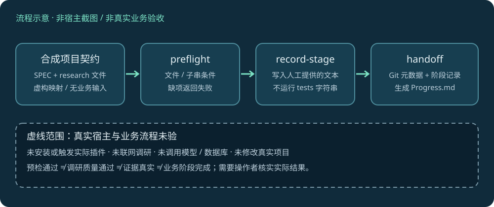
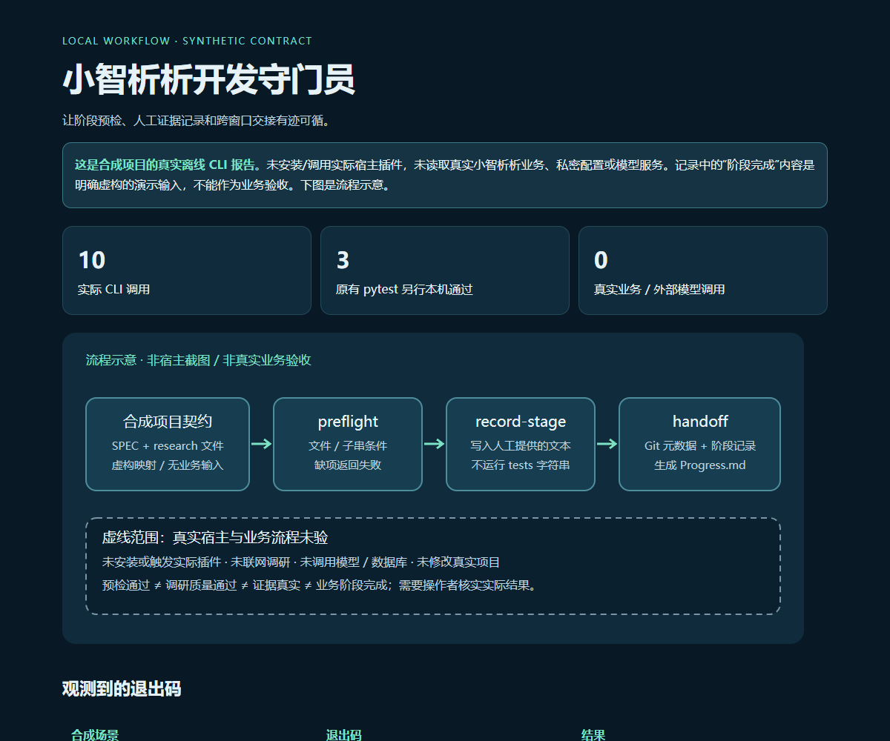

# 小智析析开发守门员

把每个开发阶段需要的调研、工具映射与交接记录放进明确的本地文件契约。这个小型 Codex 插件包含一个 Skill 和一个 Python CLI：**预检下一阶段、记录人工提供的验证结果、生成跨窗口 `Progress.md`**。

原作者清单：**知微智学** · 原版本：`0.1.0+codex.20260714181237` · 归档维护：`yangwei251003` · [MIT](LICENSE)

**状态：已有源码与离线验证的项目定制工具，真实宿主/业务接入待验证。** 本仓库保留 7 个原始源文件，新增文档与虚构示例。对应业务开发线已在 [zhiwei-ai-learning](https://github.com/yangwei251003/zhiwei-ai-learning) 同仓的 `variants/local-stage7` 归档；本仓库只存开发流程插件。



上图为流程示意，虚线宿主环节未测试。下方链接展示真实离线 CLI 的执行结果，不提供在线修改项目或调用模型的服务：[在线查看合成报告](https://yangwei251003.github.io/xiaozhixixi-dev-guardian/) · [仓库内报告](docs/index.html)。



这是本次本地浏览器截取的离线报告界面，数据来自合成项目的实际命令调用；没有把它当成宿主插件或真实业务运行截图。

## 功能与实际边界

| 命令 | 实际行为 | 需要的项目文件 |
|---|---|---|
| `preflight` | 检查规格、调研文件和工具映射是否存在；用阶段/任务子串匹配表格行 | `SPEC.md`、`research/skills-map.md`、对应阶段调研 |
| `record-stage` | 将用户提供的 summary/tests/next 写入 `research/stage-status.json` | `SPEC.md`；没有 research 目录时会创建 |
| `handoff` | 检查指定阶段已记录，读取 Git 元数据并生成/覆盖 `Progress.md` | `SPEC.md`、对应阶段状态 |

阶段范围为 0–7。阶段 0 使用 `research/调研报告.md`，阶段 1–7 使用 `research/stage-N-research.md`。

**预检通过只证明当前实现的文件/字符串条件满足。** 它不检查调研质量、真实模型结果、工具安装状态、测试是否真的执行或业务功能是否完成。`record-stage` 不运行 `--tests` 的文本；记录者负责提供真实证据。当前 Git 包装会忽略非零退出码，因此无 Git/非仓库时的 fallback 文字不能当作工作区干净的证明。代码不会读取 `.env` 内容。

Skill 原文包含研究优先、TDD、按两阶段交接等特定项目流程建议；它不覆盖宿主规则、用户授权或当前项目事实，不会自行启用/安装工具。`preflight` 不执行所匹配的 Skill。`record-stage` 和 `handoff` 会写指定项目，后者会覆盖已有 `Progress.md`，使用真实项目之前请先检查目标和备份。

## 最简运行：无需安装插件

前置：Python 3.10+（本机验证 3.12）、可选 Git（合成演示用它建立独立空仓库以展示真实状态）。CLI 只用 Python 标准库，不需要 npm、模型账户或网络。

```powershell
git clone https://github.com/yangwei251003/xiaozhixixi-dev-guardian.git
cd xiaozhixixi-dev-guardian
python examples/run_demo.py --workspace .runtime/demo
python examples/build_preview.py --results .runtime/demo/results --output .runtime/site
python -m http.server 8765 --directory .runtime/site
```

打开 `http://127.0.0.1:8765/`。示例仅在显式指定的合成目录写文件；已有非合成目录会被拒绝，不需要真实小智析析项目。重复示例请另选空目录，例如 `.runtime/demo-2`。没有 Git 时演示会保留降级说明，不宣称 Git 验收通过。

若只想查看命令帮助：

```powershell
python skills/guard-xiaozhixixi-development/scripts/guardian.py --help
```

## 手动安装 Skill

在已支持本地 Skills 的 Codex 环境中，将 `skills/guard-xiaozhixixi-development` **整个目录**复制到当前 Codex 的技能目录。默认位置是用户目录的 `.codex/skills`；若设置了 `CODEX_HOME`，则使用其 `skills` 子目录。下面命令从仓库根运行，目标已存在时停止，避免覆盖已定制版本：

```powershell
$guardianCodexRoot = if ($env:CODEX_HOME) { $env:CODEX_HOME } else { Join-Path $env:USERPROFILE '.codex' }
$guardianDestination = Join-Path $guardianCodexRoot 'skills/guard-xiaozhixixi-development'
if (Test-Path -LiteralPath $guardianDestination) { throw '目标已存在，请先检查版本和备份。' }
New-Item -ItemType Directory -Path (Split-Path -Parent $guardianDestination) -Force | Out-Null
Copy-Item -LiteralPath 'skills/guard-xiaozhixixi-development' -Destination $guardianDestination -Recurse
```

按宿主支持的刷新方式加载，然后在新会话显式请求 `$guard-xiaozhixixi-development`。本次没有执行真实宿主安装或触发。若宿主提供本地插件导入入口，可选择含 `.codex-plugin/plugin.json` 的仓库根；实际入口与兼容性需在该宿主版本核实。两种安装方式择一，避免重复注册；独立 CLI 始终可运行。

## 参数示例

以下只针对已经由 `run_demo.py` 创建的合成项目。用户接入真实项目时需自行准备当前规格/调研并显式替换路径；仓库未自带真实业务规格或秘密配置。

```powershell
python skills/guard-xiaozhixixi-development/scripts/guardian.py preflight --project-root .runtime/demo/project --stage 0 --task '合成契约检查'
python skills/guard-xiaozhixixi-development/scripts/guardian.py record-stage --project-root .runtime/demo/project --stage 0 --summary '演示记录' --tests '仅示例文本，未代表业务测试' --next '补真实验收'
python skills/guard-xiaozhixixi-development/scripts/guardian.py handoff --project-root .runtime/demo/project --completed 0,1 --next-stage 2
```

预检满足条件退出 0，缺调研/映射退出 2；缺 `SPEC.md`、交接缺阶段记录会停止。`--stage`/`--next-stage` 只能取 0–7；`--project-root` 必须提供。交接会查询本地 Git 分支、最近提交和工作区状态，不推送或联系远端。

## 开发与验证

```powershell
python -m venv .venv
.venv/Scripts/python -m pip install -r requirements-tested.txt
.venv/Scripts/python -m pytest skills/guard-xiaozhixixi-development/tests -c skills/guard-xiaozhixixi-development/pytest.ini
```

macOS/Linux 使用 `.venv/bin/python`。`pytest-asyncio` 仅用于兼容保留的原 pytest 配置；CLI 本身没有第三方依赖。

本机实际运行：原有 3 项 pytest、完整合成 CLI 预检/记录/交接、缺调研与缺阶段记录分支、必填参数和阶段范围拒绝。结果见 [验证数据](examples/offline-results/validation.json)。演示只验证本地软件行为，不证明真实调研已完成或业务阶段通过。未实测全新依赖联网安装、其他操作系统、宿主插件 UI/隐式触发、真实业务或外部模型。

## 目录

```text
.codex-plugin/plugin.json                 # 原插件清单
skills/guard-xiaozhixixi-development/
  SKILL.md · agents/openai.yaml           # 原流程与宿主定义
  references/handoff-schema.md            # 原交接约定
  scripts/guardian.py · tests/            # 原工具及 3 项测试
examples/contract/                       # 最小合成规格/研究映射
examples/run_demo.py · build_preview.py   # 离线示例和报告构建
examples/offline-results/                # 实际合成运行结果，路径已泛化
docs/                                   # 离线 HTML 报告与明确示意图
```

更新与未完成事项见 [CHANGELOG](CHANGELOG.md)，归属和依赖边界见 [NOTICE](NOTICE.md)。原始真实业务资料、配置与日志不公开，本仓库也不构成可删除真实项目的依据。
